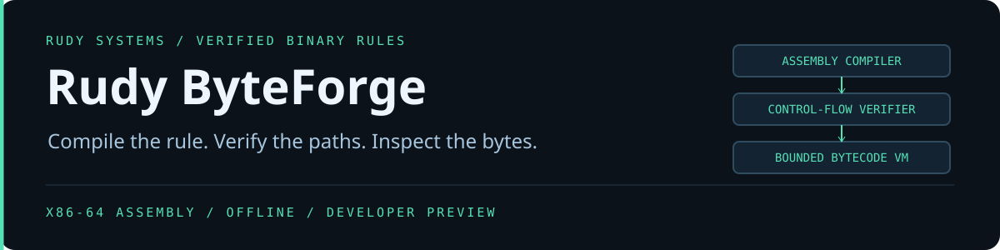

<p align="center"></p>
<p align="center"><a href="https://rudy.systems">Rudy Systems</a> · <a href="https://github.com/r4venrudy/rudy-byteforge/releases">Native downloads</a> · <a href="docs/FORMAT.md">Bytecode format</a> · <a href="#quick-start">Quick start</a></p>

# Rudy ByteForge

**A binary-rule compiler, control-flow verifier and virtual machine written in x86-64 Assembly.** Compile readable expressions over packet or file bytes, inspect the resulting bytecode, and execute bounded rules over explicit inputs or classic PCAP captures.

The Assembly core owns lexical scanning, unsigned-integer overflow checks, precedence parsing, short-circuit branch emission, stack-state verification and execution. A small C interface handles files, console output and capture framing. Python assembles release archives and runs independent tests.

Repository language statistics focus on the shipped native core in `asm/`, `src/` and `include/`. The explicitly excluded `tests/` and `tools/` directories contain validation and build infrastructure. Binary fixtures are marked binary and source files use LF endings for consistent checkouts.

**v0.1.0-preview · NASM Assembly · Windows x64 / Linux x64 · MIT**

## What makes it useful

| Component | Function |
| --- | --- |
| Assembly compiler | Decimal/hexadecimal literals, record length, bounded byte loads, arithmetic, bit masks, unsigned comparisons and boolean expressions. |
| Static verifier | Exact format/size checks, reserved-field checks, 64-value stack bounds, forward-only branches, reachable instructions and equal stack depths at control-flow joins. |
| Assembly VM | 64-bit integer semantics, endian-aware reads, short-input results and independent instruction fuel. No JIT or guest system calls. |
| Inspection | Disassemble compiled rules and report maximum stack depth before using them. |
| Capture analysis | Scan classic PCAP in both byte orders and microsecond/nanosecond variants. Report match counts and up to 1024 matching packet indices. |
| Embedding | A C ABI, shared library and header for applications that need a small read-only predicate engine. |

## Quick start

Download the archive for your architecture from the [preview release](https://github.com/r4venrudy/rudy-byteforge/releases/tag/v0.1.0-preview). Compare its SHA-256 with `SHA256SUMS.txt`, extract it, and use `bin/byteforge` on Linux or `bin/byteforge.exe` on Windows.

```sh
bin/byteforge compile examples/tcp-syn.bf tcp.bfg
bin/byteforge verify tcp.bfg
bin/byteforge disasm tcp.bfg
bin/byteforge run tcp.bfg examples/tcp.bin
bin/byteforge scan tcp.bfg examples/traffic.pcap
```

The supplied synthetic capture contains two records. The example matches the first:

```json
{"schema":"rudy.byteforge.scan/v1","link_type":1,"packets":2,"matches":1,"short_inputs":0,"arithmetic_errors":0,"indices":[0],"indices_truncated":false}
```

`compile` creates a new output file and preserves an existing file at that path. Choose a new name when compiling again. Inputs and captures are read locally; commands never transmit packets or execute captured content.

## Rule language

```text
len >= 54 && u16be(12) == 0x0800 && u8(23) == 6 && (u8(47) & 2) != 0
len >= 4 && u32be(0) == 0x7f454c46
(u8(0) ^ 0x20) == 0x41 || len == 0
```

These examples inspect fixed offsets. The first is intended for ordinary Ethernet + unfragmented IPv4 + a 20-byte IPv4 header; it is not a complete TCP/IP decoder. VLAN tags, IP options, fragmentation and other link types require a different rule. `scan` reports the capture's link type and does not infer an offset layout for you.

| Expressions | Meaning |
| --- | --- |
| `123`, `0xff`, `len` | Unsigned 64-bit decimal/hexadecimal values and captured input length. Leading-zero numbers remain decimal. |
| `u8(n)`, `u16be(n)`, `u32be(n)`, `u64be(n)` | Read at an unsigned literal offset; multi-byte values are big-endian. |
| `u16le(n)` | Read 2 bytes at an unsigned literal offset, interpreted little-endian. |
| `u32le(n)` | Read 4 bytes at an unsigned literal offset, interpreted little-endian. |
| `u64le(n)` | Read 8 bytes at an unsigned literal offset, interpreted little-endian. |
| `+ - & ^ \| << >>` | Arithmetic/bit operations. Arithmetic wraps modulo 2^64. Shift counts at least 64 produce zero. |
| `*` | Unsigned multiplication wraps modulo 2^64. |
| `/` | Unsigned quotient; an executed zero divisor returns an arithmetic error. |
| `%` | Unsigned remainder; an executed zero divisor returns an arithmetic error. |
| `== != < <= > >=` | Unsigned comparisons producing 0 or 1. |
| `! ~`, unary `+ -` | Logical NOT, bit inversion, identity and modular negation. |
| `&& \|\|` | Left-to-right short-circuit boolean operations producing 0 or 1. |

Precedence from lowest to highest is `||`, `&&`, `|`, `^`, `&`, equality, ordering, shifts, addition/subtraction, multiplication/division/remainder, then unary operators. Binary operations are left-associative. Parentheses override precedence. Load offsets are literals, not computed expressions. Strings, variables, loops and function definitions are outside this language.

Guard potentially short reads with `len` and `&&`. An executed out-of-bounds read returns `BF_SHORT_INPUT`; it does not quietly turn into a match or read outside the supplied span. `0 && u64be(0)` succeeds with value zero on empty input because the load is skipped.

## Commands and results

| Command | Result |
| --- | --- |
| `compile source.bf output.bfg` | Compile and verify, then write a fresh bytecode file. Syntax/capacity errors include a source byte offset. |
| `verify program.bfg` | Report instruction count and maximum stack depth. |
| `disasm program.bfg` | Print instruction indices, operation names and immediates. |
| `run program.bfg input.bin` | Report the unsigned value and whether it is nonzero. |
| `scan program.bfg capture.pcap` | Report packet/match/truncation counts and zero-based matching indices. |

Exit 0 means success/match, exit 1 means a successfully evaluated non-match, exit 2 means invalid arguments/files/program/source, exit 3 means an executed short read in `run`, and exit 4 means an executed zero divisor in `run`. `scan` counts short-input and arithmetic-error records separately and continues. Skipped branches do not evaluate a zero divisor. Malformed capture framing rejects the scan without a success report. JSON schemas use the `rudy.byteforge.*/v1` names shown in output.

## Build and test

Use **NASM 2.16 or later**, Python 3.12 or later, and a GNU-compatible C toolchain. Linux supports Clang/GCC. Windows uses LLVM-MinGW Clang or MinGW-w64 GCC, rather than the MSVC linker mode. The initial release targets x86-64, not ARM64 or 32-bit x86.

```sh
python tools/build.py --nasm nasm --cc clang
python tests/native.py build/libbyteforge.so
python tests/differential.py build/libbyteforge.so
python tools/check.py --nasm nasm --cc clang
python tests/integration.py build/byteforge .
```

On Windows use `build/byteforge.dll` and `build/byteforge.exe`. Put your NASM and compiler executables on PATH, or provide their full paths to the build/check scripts. CI exercises both native platforms, including guard pages and register-preservation probes. Run `python tools/package.py --platform linux-x64` (or `windows-x64`) after testing to create an archive and checksum manifest. Packages include `lib/libbyteforge.a`, the shared library and `include/byteforge.h`. The standalone `examples/embed.c` consumer is compiled and executed against both the build and extracted static libraries. See [the architecture and API contract](docs/FORMAT.md) for embedding details.

Validation includes 2500 seeded expression comparisons against an independent Python evaluator, 5000 bytecode mutations compared with an independent verifier, 400 concurrent compile/evaluate calls, explicit capacity boundaries, real guard-page boundaries, and three public-API register probes. These are bounded test samples, not a proof that all possible inputs are correct. Assembly is not instrumented by C sanitizers.

## Analysis boundaries

Programs contain at most 1024 fixed-size instructions and use at most 64 operand values. The compiler accepts at most 8192 source bytes and 64 active parser frames. Runtime fuel is at most the program's instruction count. The core uses no heap allocation, mutable global state, system calls or executable output memory.

The C file interface limits single binary inputs to 16 MiB. The classic-PCAP adapter accepts snapshots up to 16 MiB, captures up to 256 MiB and one million records. It validates framing and length fields, not all packet protocols or checksums. PCAPNG, live capture and automatic protocol dissection are outside this preview. Matching indices are capped at 1024; omitted indices are explicitly reported.

The public C API requires valid, suitably sized, immutable input/program spans and valid, non-overlapping output structures. Bytecode is untrusted; host pointers and concurrent mutation by the embedding application are outside that trust boundary. Keep buffers immutable through each call. Windows unwind records are emitted for framed Assembly functions. Throwing C++ exceptions across these APIs and ELF stack-unwind debugging are not supported contracts.

This is a developer preview for offline rule evaluation. It is not a kernel filter, native-code compiler, malware detector or replacement for tcpdump/libpcap's filter language.

---

<p align="center"><strong>RUDY SYSTEMS</strong><br>Systems engineering · Security research · Reviewable evidence<br><a href="https://rudy.systems">rudy.systems</a></p>
